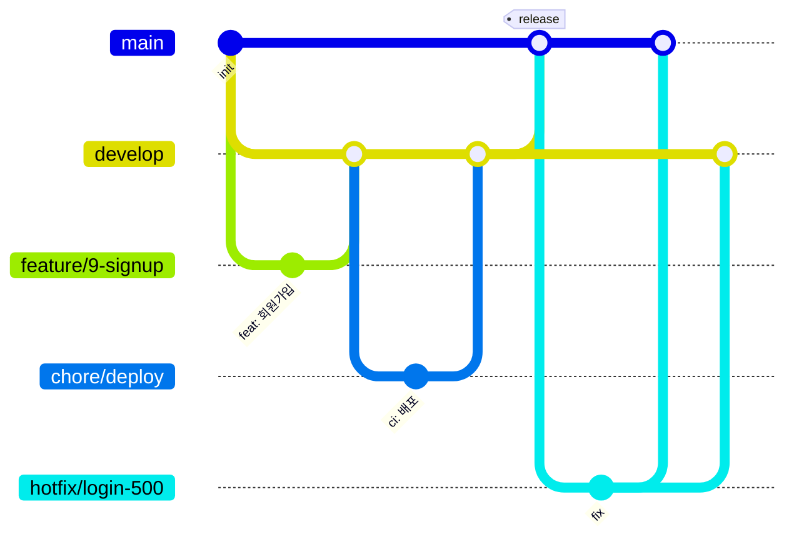

# 기여 가이드

AfterMe 백엔드 저장소의 커밋, 브랜치, PR 규칙입니다.

## 커밋 메시지 컨벤션

```
<type>: <요약> (#이슈번호)

- 변경 내용 1
- 변경 내용 2
```

| type | 용도 | 예시 |
|---|---|---|
| `feat` | 기능 추가 | `feat: 회원가입 API 구현 (#9)` |
| `fix` | 오류 수정 | `fix: 후임자 참여 API 경로 수정 (#14)` |
| `refactor` | 동작 변화 없는 구조 개선 | `refactor: 인수인계 조회 쿼리 분리 (#13)` |
| `docs` | 문서 | `docs: 배포 가이드 추가 (#{번호})` |
| `test` | 테스트 추가·수정 | `test: 인터뷰 답변 이력 통합 테스트 추가 (#21)` |
| `chore` | 설정·빌드·의존성 | `chore: Dockerfile 추가 (#{번호})` |
| `ci` | CI/CD 워크플로 | `ci: main 배포 워크플로 추가 (#{번호})` |

- 요약은 한국어로, 마침표 없이 50자 이내로 씁니다.
- 한 커밋에는 한 가지 목적만 담습니다. (기능 / 설정 / 문서를 섞지 않기)
- 본문에는 "무엇을, 왜" 바꿨는지 적습니다.
- 비밀번호·토큰·API 키 등 비밀값은 커밋하지 않습니다. 값 없는 `.env.example`만 공유합니다.

## 브랜치 네이밍 컨벤션

```
<type>/<이슈번호>-<기능-이름>
```

| 브랜치 | 형식 | 예시 |
|---|---|---|
| 기능 | `feature/{이슈번호}-{기능}` | `feature/9-signup` |
| 설정·인프라 | `chore/{이슈번호}-{내용}` | `chore/{번호}-deploy` |
| 수정 | `fix/{이슈번호}-{내용}` | `fix/14-invitation-api-paths` |
| 긴급 수정 | `hotfix/{내용}` | `hotfix/login-500` |

- 영문 소문자와 하이픈(`-`)만 사용합니다.
- 작업 전에 GitHub 이슈를 먼저 만들고, 그 번호를 브랜치 이름에 넣습니다.

## 브랜치 전략 (Git Flow)



| 브랜치 | 역할 | 생성 기준 | 머지 대상 |
|---|---|---|---|
| `main` | 배포 브랜치. push 시 EC2에 자동 배포 | - | - |
| `develop` | 기능 통합·검증 | `main` | `main` (릴리스 PR) |
| `feature/*` | 기능 개발 | `develop` | `develop` |
| `chore/*` | 설정·빌드·인프라 | `develop` | `develop` |
| `fix/*` | develop에서 발견한 오류 수정 | `develop` | `develop` |
| `hotfix/*` | 운영 긴급 수정 | `main` | `main` + `develop` |

- `main`, `develop`에는 직접 커밋·push하지 않고 PR로만 머지합니다.
- 작업 시작 전에 `git pull origin develop`으로 최신 develop을 받은 뒤 브랜치를 만듭니다.
- `main` 머지는 곧 운영 배포입니다. develop에서 동작을 확인한 뒤 릴리스 PR을 엽니다.
- hotfix는 `main`에 머지한 뒤 같은 변경을 `develop`에도 반영합니다.

## PR 규칙

**제목**: 커밋 메시지와 같은 형식 — `feat: 회원가입 API 구현 (#9)`

**본문 템플릿**

```markdown
## 변경 목적
- 왜 이 변경이 필요한지

## 변경 내용
- 주요 변경 사항

## API · DB 변경
- 추가/변경된 API (메서드, 경로, 요청·응답)
- 마이그레이션 파일 (V{n}__...sql), 없으면 "없음"

## 확인 결과
- 실행한 테스트, 수동 확인 내용

## 남은 제한사항
- 이번 PR에서 다루지 않은 부분, 후속 작업

Closes #이슈번호
```

- 기능 PR의 base는 `develop`입니다. (hotfix만 `main`)
- 리뷰어 1명 이상 승인 후 머지합니다.
- 테스트가 통과하지 않은 PR은 머지하지 않습니다.
- 이슈를 일부만 해결했다면 `Closes` 대신 `Ref #번호`를 씁니다.
- 머지 후 작업 브랜치는 삭제합니다.
